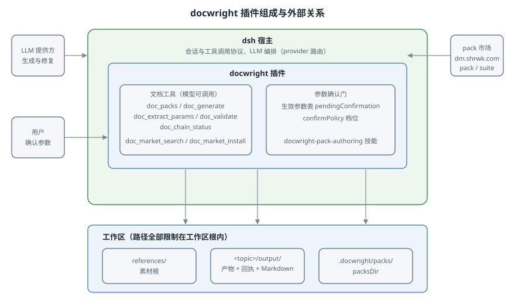

# 2. 组成与外部关系

## 插件在 dsh 宿主中的位置

docwright 以 dsh 插件形式安装（`dsh plugin add @sharework-ai/dsh-docwright`），向宿主注册五个工具（`doc_packs`、`doc_generate`、`doc_extract_params`、`doc_validate`、`doc_chain_status`）以及两个市场工具（`doc_market_search`、`doc_market_install`）。模型在会话中通过这些工具使用文档生成能力；宿主负责会话、工具调用协议与 LLM 编排，docwright 负责文档生成、校验与回执。

插件在装载期完成全部自检：pack 清单加载、manifest 与规则校验、配置合法性检查。任何一项不通过，插件启动即报错，不会带着坏配置进入会话（fails loud 原则）。



## 功能组件

插件由五块功能组成，各组件只通过工具接口与文件目录对外可见：

| 组件 | 对外可见的行为 |
|---|---|
| 能力发现 | `doc_packs` 列出已安装 pack；未知 pack 报错时提示先调用 `doc_packs` |
| 生成与校验 | `doc_generate` 闭环生成；`doc_extract_params` 素材参数抽取；`doc_validate` 离线复验与封章；`doc_chain_status` 链覆盖对账 |
| pack 市场 | `doc_market_search` 查询市场；`doc_market_install` 在用户确认后安装 pack 或 suite，装入 packsDir 后当期会话可用 |
| pack 编写支持 | 随包注册 `docwright-pack-authoring` 技能；`pnpm run pack:check` 提供本地 pack 的装载与 golden 校验 |
| 参数确认门 | 生成前对生效参数出确认表，`confirmPolicy` 配置确认档位 |

## pack 的来源与存放

插件本体不含任何 pack，pack 是内容，从市场分发。可用来源有两处：

- **市场安装**：`doc_market_install` 装入 Config `packsDir`（惯例 `<workspace>/.docwright/packs/`）；同名 pack 覆盖内置来源。
- **本地编写**：按 pack 契约编写目录后放入 packsDir，重新加载插件即生效；验证用 `pnpm run pack:check`。

COSMIC 系列 pack（context、plan、req、func、tech、context-sync）在本仓库 `packs/` 目录维护编写源码，同时发布到市场。

## 工作区目录

工作区是每次会话的根目录（dsh web UI 中选择的目录），docwright 的全部读写都限制在其内部，越界即报错。默认布局：

```
<workspace>/
├── references/            ← workspace 级素材根
├── context/               ← workspace 级产物目录（workspace 作用域 pack 固定使用）
├── <topic>/               ← 话题目录，一个工作项一个（如 REQ-142-favorites）
│   ├── references/        ← topic 级素材根
│   └── output/            ← topic 级产物根（产物 JSON + 回执 + Markdown）
└── output/                ← 未指定 topic 时的产物根
```

素材根与产物根可用 Config `materialsRoot` / `outputRoot` 调整（相对路径拼接到工作区根，绝对路径也必须位于工作区根内）。

## LLM 路由

`doc_generate` 的模型调用走宿主 LLM 编排中已注册的路由，由 Config `provider` + `model` 指定（例如 `deepseek-official` + `deepseek-chat`）。未配置路由时 `doc_generate` 调用即报错。`doc_validate`、`doc_chain_status`、`doc_packs`、`doc_extract_params` 均为确定性工具，不调用模型。

## 配置

全部可调项集中在 Config（cordis.yml 的插件配置段），无硬编码：

```yaml
- id: docwright
  config:
    packsDir: ""            # 市场与本地 pack 的安装目录；同名覆盖内置
    marketSearch: true      # 是否启用 doc_market_search 与市场查找提示
    loadBuiltinPacks: true  # 是否加载包内自带 pack 目录
    marketUrl: ""           # pack 市场地址（默认 https://dm.shrwk.com）
    workspaceRoot: ""       # 无会话工作区时的兜底根（默认进程 cwd）
    materialsRoot: ""       # 素材根（默认 <workspace>/references）
    outputRoot: ""          # 产物根（默认 <workspace>/output）
    defaultLanguage: "zh-CN"
    maxIterations: 5        # 修复循环默认轮数
    maxRoundsCeiling: 10    # 轮数绝对上限，任何覆盖不可突破
    promptTokenBudget: 60000
    upstreamVersionPolicy: "strict"  # 链上上游 pack 版本不符：strict 拒绝，warn 放行并附告警
    confirmPolicy: "standard"  # 参数确认门档位：none / standard / strict
    oscillation:            # 修复循环提前终止策略
      mode: auto            # auto | score | fingerprint
      stagnantRounds: 3
      decliningRounds: 3
      maxRepeats: 3
      epsilon: 0
      defaultScore: { error: 10, warning: 3, info: 1 }
    provider: "deepseek-official"  # 宿主 LLM 路由名
    model: "deepseek-chat"
```

注意两点：`provider` 填的路由名必须在宿主 LLM 编排中存在，路由名不存在时表现为空流而非响亮报错，`doc_generate` 第一轮报 llm-error 时先核对路由名；传给路径参数的 Windows 盘符路径（如 `D:\x\y`）在 Linux 宿主上会先归一化为对应的 WSL 挂载路径。
