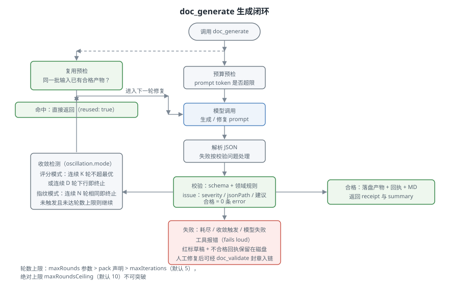

# 4. 生成闭环

`doc_generate` 把"生成一份合格文档"组织为一个闭环：模型产出，校验器把关，不合格时问题清单回传模型重写，直到全部合格或闭环终止。本章描述这个闭环对外可见的行为。

## 闭环的每一轮

1. **预算预检**：估算本次 prompt 与当前产物的 token 用量，超过 Config `promptTokenBudget` 时报错，提示拆分素材或调大预算，不消耗模型调用。
2. **模型调用**：按 Config 路由调用模型。传输失败自动重试一次；调用失败映射为一条内部 issue，本轮按失败结束并保留已有草稿。
3. **解析**：从模型输出中提取 JSON。解析失败与校验失败走同一条修复路径。
4. **校验**：先按 pack 的 JSON Schema 校验结构，再执行 pack 的领域规则（声明式规则与函数规则）。全部发现统一为 issue 格式：`{ ruleId, severity, jsonPath, message, snapshot?, suggestion? }`，severity 取 `error`/`warning`/`info`。
5. **判定**：**全部合格的判定标准是 0 条 error**。warning 与 info 不拦截，但计入评分。合格即成功返回；否则组装修复 prompt 进入下一轮。

修复 prompt 在原生成 prompt 的基础上附上当前产物 JSON 与按字段分组的问题清单，并指示模型只修复列出的问题、输出完整 JSON。pack 规则必须逐条携带 `suggestion`（pack 加载期强制），保证修复提示的质量不随 pack 作者漂移。

## 轮次上限

生效轮数按优先级取值：调用参数 `maxRounds`，其次 pack manifest 的 `maxRounds`，其次 Config `maxIterations`（默认 5）。无论哪一层，都不能突破 Config `maxRoundsCeiling`（默认 10），该上限由宿主运维持有。

## 收敛检测

修复有时不会好转：模型可能反复给出同样的问题集，或在修好一处的同时弄坏另一处。收敛检测在轮数耗尽之前识别这类情形并提前终止，避免无意义的开销。提前终止只决定何时放弃；合格判定始终是 0 条 error，评分不参与合格判定。

评分按 `oscillation.mode` 选择来源：

| 模式 | 评分来源 | 说明 |
|---|---|---|
| `auto`（默认） | pack 评分，未提供时用内置评分 | pack 在规则文件中导出 `score(artifact, issues)`（0-100，越高越好）则使用之 |
| `score` | 强制 pack 评分 | pack 未导出 `score` 时调用报错 |
| `fingerprint` | 无评分 | 按每轮 issue 指纹判断：连续 `maxRepeats`（默认 3）轮完全相同即终止 |

内置评分为严重度加权：`clamp(100 − 10×error − 3×warning − 1×info, 0, 100)`，权重可用 `defaultScore` 配置调整。

带评分时两条终止规则并行，先到先终止（阈值可配，默认各 3）：

- **停滞（stagnation）**：连续 `stagnantRounds` 轮没有超过历史最优分。单轮回撤被容忍，第 3 轮创新高即重置计数。
- **下行（decline）**：连续 `decliningRounds` 轮评分严格下降。

## 终止结果

闭环终止时 `terminationReason` 写入回执，取值：

| 原因 | 含义 |
|---|---|
| 合格回执无此字段 | 0 条 error，产物有效 |
| `stagnation` / `decline` | 收敛检测触发提前终止 |
| `fingerprint-repeat` | 指纹模式连续重复 |
| `max-iterations` | 轮数耗尽 |
| `llm-error` | 模型调用失败 |

## 失败时保留红标草稿

闭环失败（耗尽或模型失败）时工具报错，但磁盘上保留两份文件：最后一轮产物草稿与不合格回执（`isValid: false` 加全部未解决 issue）。草稿可供人工直接修改：改到合格后用 `doc_validate` 复验并封章，产物重新入链，不需要重新生成。docwright 从不静默采用不合格的最后一轮产物。

## 产物落盘

闭环成功后写三个文件：产物 JSON、sidecar 回执（`<产物名>.receipt.json`）与 Handlebars 模板渲染出的 Markdown，全部原子写入。返回值内联全量回执与 `summary` 关键计数（functions/processes/subProcesses/totalCfps），调用方不必回读文件。

## 复用预检

生成开始前，docwright 检查同一批输入是否已有合格产物：同 pack、同版本、产物内容一致、素材清单一致、（链式 pack）上游锚点一致。全部命中时直接返回已有产物（`reused: true`），零模型调用；任一不一致或 `force: true` 时正常生成。这意味着重复调用 `doc_generate` 不会重复花费模型调用，而素材或参数的任何变化都会触发重建。
