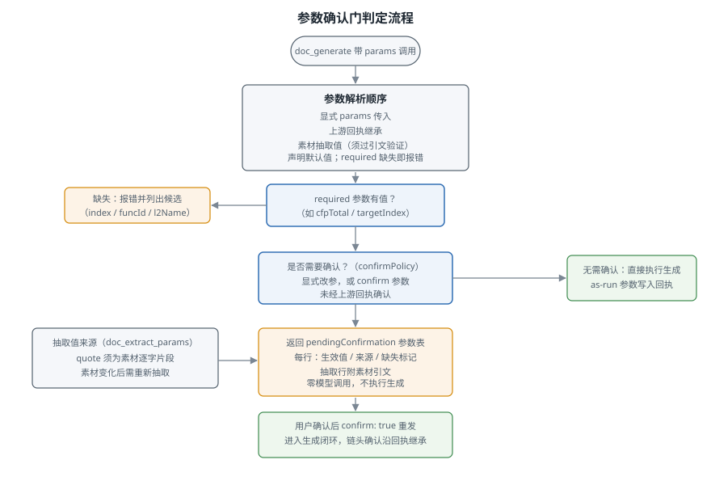

# 6. 参数与确认门

pack 可以为一类文档声明可调参数（如 CFP 预算、模块层级深度、角色白名单）。参数把"文档标准中的数值与清单"从模板写死变成调用方可控，且每个生效值都有来源、可追溯、必要时经用户确认。本章描述参数的使用语义。

## 参数声明与属性

pack 在 manifest 中逐参数声明，声明即白名单：未声明的名称传给 `doc_generate.params` 直接报错。每个参数携带：

| 属性 | 语义 |
|---|---|
| `type` | `number` / `string` / `boolean` / `object` |
| `description` | 参数含义，`doc_packs` 原样返回给模型 |
| `default` | 缺省值；`required: true` 的参数禁止声明默认 |
| `enum` / `min` / `max` | 取值约束，越界报错 |
| `required` | 无默认值的必备参数：未经显式提供即拒绝执行（如 `cfpTotal` 预算、扇出寻址的 `targetIndex`） |
| `confirm` | 参与确认门：该参数未经上游回执确认时，生成前要求用户确认 |
| `overridable` | 允许生成阶段在素材许可范围内调整该参数（一句话提示进 prompt；不放松任何校验）。声明 `overridable` 必须同时 `confirm` |
| `extractable` | 可由 `doc_extract_params` 从素材抽取，同样强制 `confirm` |

两条规则提示参数的使用边界：被校验规则直接引用的参数（数值边界、正则来源）不允许 `overridable`，否则调整必然撞上自己的规则；链上继承的参数在下游 pack 中声明时不填默认值，避免死数据。

## 参数解析顺序

`doc_generate` 按固定顺序解析每个参数的生效值：

1. 本次调用显式传入的 `params`；
2. 上游回执继承（链头已确认的参数沿链传递，下游不再重复确认）；
3. 抽取值（仅 `extractable` 参数，须通过引文复验）；
4. 声明的默认值；
5. `required` 且无默认仍无值：拒绝执行并列出候选（扇出参数如 `targetIndex` 会列出上游全部功能）。

对话中用户表达的意图由 agent 转译为显式 `params`，这是参数的正道入口；素材正文不能隐式改写参数，参数只能通过上述通道生效。

## 素材抽取（doc_extract_params）

有些参数写在素材里（如需求文档明确"预期 CFPs 为 70"）。`doc_extract_params` 把"读素材、取参数"变成有出处的过程：

- 对每个 `extractable` 参数，模型提出 `{ value, quote }`，`quote` 必须是素材的逐字片段，引擎验证引文后值才生效；
- 素材中没有的值提 `{ notFound: true }`，可附 `suggestion` 与 `rationale`；建议值只能经用户显式认可后通过 `params` 进入，不会自动生效；
- required 参数抽取不到时，生成开始前被拦截，要求用户提供值或认可建议值。素材缺值不被模型代答；
- 抽取结果落盘为 `<pack>.extracted.json`。素材变化后原引文失效，相关抽取值作废，需重新抽取。

抽取后的值出现在确认门参数表中，每行附引文，用户可核对"这个数确实来自素材"。

## 确认门（confirmation gate）

确认门在生成执行前核对生效参数。判定条件：

> 需要确认，当本次调用显式传了 `params`，或存在 `confirm: true` 的参数且其值未经上游回执确认。

命中且未确认时，`doc_generate` 返回 `pendingConfirmation` 与一张生效参数表，不执行生成，零模型成本。表中每行给出：参数名、生效值（无值行省略）、来源（pack 默认 / 显式传入 / 上游继承 / 抽取引文）、required 缺失标记，以及参数漂移的影响预判（确认后将重新生成上游，或新参数下重验仍合规）。调用方把参数表转呈用户，用户确认后带 `confirm: true` 重发同一调用即执行。链式 pack 首次进入一个 topic 时，`topic` 行也在表首，由用户确认或纠正。

确认档位由 Config `confirmPolicy` 决定，可用同名调用参数按次覆盖：

| 档位 | 行为 |
|---|---|
| `none` | 从不要求确认，适合 headless 与 CI；required 缺失仍然报错，as-run 参数照常入回执 |
| `standard`（默认） | 显式改参或 confirm 参数未经上游确认时要求确认；与上游回执完全一致的传参视为继承回显，不再确认 |
| `strict` | 只要有参数表可展示就要求确认，每个阶段都过一遍用户确认 |

全链只确认一次：共享参数在链头声明并确认，生效值写入链头回执，下游阶段继承，继承不再触发确认。下游显式传参与回执不一致才视为改参、重新进入确认门。

## 参数漂移（param drift）

下游阶段生成时，若回执继承的参数与本次传入的参数不一致，按 pack 声明的 `paramDriftPolicy` 处理：

- `regenerate`（默认）：参数漂移即要求重新生成上游产物，报错并指明变更的参数；
- `revalidate`：按新参数对上游产物做确定性重验（零模型调用），合格则链继续并在回执记录漂移，不合格则报错列出未通过的规则。

## Mind the gap：只有目标值进生成上下文

带区间端点的参数（如 `cfpPerFunc: { value: 30, min: 15, max: 45 }`）中，只有目标值 `value` 渲染进生成 prompt；`min`/`max`/`downFactor`/`upFactor` 是校验容差，只作用于规则与回执，通过修复回路的问题消息到达模型。这样模型不会把校验容差当作写作目标去贴合，避免"凑带宽"式的产出。

## 生效参数可审计

无论参数经哪个通道解析而来，最终生效值都以 as-run 形式写入回执，并渲染进生成 prompt。任何一次生成的参数取值都能从事后产物与回执中复核。
