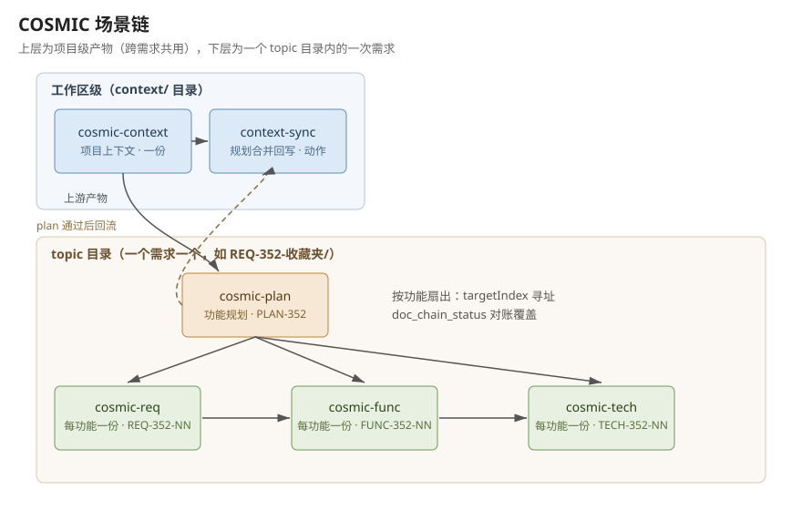

# 第 7 章 场景链

一个场景往往需要多份文档按顺序产出。docwright 用链组织这个过程：每个包声明自己消费哪类上游产物（manifest 的 `consumes` 字段），生成时通过 `doc_generate` 的 `upstream` 参数传入上游产物的路径。引擎校验每份上游产物带有合格回执后才放行，生成不完整或校验不合格的上游产物无法进入下游。

## COSMIC 链的六个包

COSMIC 功能点估算场景由六个市场包组成，链路如下：

- `cosmic-context`：项目上下文。模块树、角色、第三方系统、编号规则、设计原则。整个项目一份。
- `cosmic-plan`：功能规划。基于上下文规划新增和修改的模块，每个被改动的叶子模块成为一个功能。每个需求一份。
- `cosmic-req`：需求分析。针对单个功能，产出功能用户、用户故事和业务规则。每个功能一份。
- `cosmic-func`：功能过程设计。把单个功能拆成功能过程。每个功能一份。
- `cosmic-tech`：技术拆分。把每个功能过程拆成数据移动并核对 CFP 预算。每个功能一份。
- `cosmic-context-sync`：上下文回流。把一个需求的规划结果合并回项目上下文，使项目知识随需求演进。整个项目一份，可重复执行。

前五个包按 "context → plan → req → func → tech" 逐级消费；`cosmic-context-sync` 同时消费 context 和 plan，在 plan 产物通过校验后即可调用。

## topic 目录：一个需求一个目录

COSMIC 链的四个阶段包（plan/req/func/tech）在 manifest 声明 `requiresTopic: true`，调用 `doc_generate` 时必须传 `topic` 参数。topic 是一个目录名，例如 `REQ-142-收藏夹`。传入后，产物写入 `<topic>/output/`，素材从 `<topic>/references/` 与 `<topic>/input/` 读取；不传时调用直接报错。

一条需求的所有产物（plan 一份、req/func/tech 每功能各一份）都落在同一个 topic 目录下，需求完成即可整体归档。topic 名还参与编号：链头包 `cosmic-context` 声明 `topicNoPattern` 参数（一个正则，经确认后沿链继承），引擎用它从 topic 名中提取需求编号（如 `KERQ-352-收藏夹` 提取出 `KERQ-352`），该编号进入功能 ID 和产物名。

项目级的两份产物不进 topic 目录：`cosmic-context` 的产物落在工作区的 `context/` 目录，跨需求共用；`cosmic-context-sync` 同样落在这里。

topic 首次进入链时，`doc_generate` 会返回待确认参数表，其中包含 topic 本身，需要用户确认编号提取是否正确；确认一次后沿链生效，后续阶段不再重复询问。

## 按功能扇出

req、func、tech 三个包的产物粒度是单个功能。调用这三个包时必须传 `targetIndex` 参数，指明处理 plan 功能清单中的第几个功能；不传时调用报错，错误信息列出全部候选（序号、功能 ID、功能名）。一个有 9 个功能的 plan，req 层需要生成 9 份产物，func、tech 同理。

产物命名由引擎负责。这四个包都声明了 `artifactPrefix`（PLAN/REQ/FUNC/TECH），产物名固定为 `<PREFIX>-<topicNo>`（整需求产物）或 `<PREFIX>-<topicNo>-<NN>`（按功能产物，NN 是两位序号），调用方不能自选名字。命名规则保证同一功能的产物在重生成时覆盖旧版本，不同功能之间不会互相覆盖。

每份按功能产物生成成功后，返回值附带一行覆盖进度，例如 `req 层已覆盖 4/9`，提示还剩哪些功能未处理。

## 覆盖对账与 doc_chain_status

覆盖是产物集合的性质：plan 里每个功能在 req、func、tech 三层都应该有对应产物。单份产物的校验无法表达这个要求，所以由确定性工具 `doc_chain_status` 负责。传入 plan 产物的路径，它扫描同目录下各层的合格产物，返回覆盖矩阵：每个功能在哪一层有产物、哪一层缺失，以及各层的覆盖计数。

工具还会报告孤儿产物：某层存在合格产物，但其功能 ID 与 plan 中的任何功能都对不上（常见于 plan 重新生成后旧产物未清理）。收工前应跑一次 `doc_chain_status` 确认覆盖完整且无孤儿，再向用户呈现结果。

## 复用与人工修正

`cosmic-context` 声明了复用：相同输入（素材清单、参数、pack 版本一致）再次调用时直接返回已有合格产物，不调用模型。req/func/tech 也声明了复用，前提是上游锚点和素材都未变化。

人工修正过的产物不再匹配生成时的内容，但可以通过 `doc_validate` 重新校验；校验通过后回执更新到当前内容，产物重新进入链路。这样外部编辑不会把产物排除在链之外，也不会让不合格的内容蒙混过关。

## 链路图

图中上方是项目级产物（context 目录，跨需求共用），下方是一个 topic 目录内的一次需求：plan 生成后按功能扇出到 req、func、tech，plan 通过校验后可调用 context-sync 把变更合并回项目上下文。
