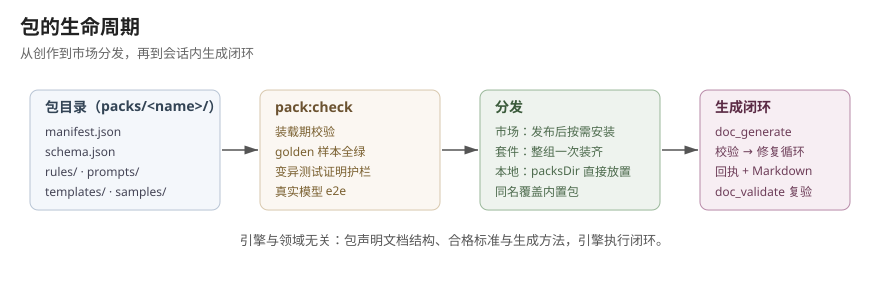

# 第 8 章 包结构与包契约

一个包是一类文档的完整生成契约。引擎负责闭环（生成、校验、修复、回执）、参数确认、上游链校验、扇出寻址和 Markdown 渲染这些通用能力；文档本身长什么样、什么算合格、怎么生成，全部由包声明。引擎不学习任何领域知识，COSMIC、CFP 这类领域概念只存在于包里。

## 目录结构

以 `packs/cosmic-plan/` 为例，一个包包含以下文件：

```
packs/cosmic-plan/
├── manifest.json        # 身份、参数、链、作用域声明
├── schema.json          # 文档结构（draft-07 JSON Schema）
├── rules/zh-CN.json     # 声明式规则（简单规则族）
├── rules/functions.js   # 函数规则（跨字段、跨产物规则）
├── prompts/zh-CN.md     # 生成提示词（双语各一份）
├── templates/zh-CN.hbs  # Markdown 渲染模板
└── samples/golden.json  # 合规样本，必须全绿
```

各文件职责：

- **manifest.json**：包名、版本、description、consumes、languages、requiresTopic、artifactPrefix、scope、reuse、params、paramDriftPolicy、maxRounds。加载期逐项校验。
- **schema.json**：定义文档的字段、类型、enum、required 和嵌套结构。schema 管结构合法性，每次校验都执行。
- **rules/&lt;lang&gt;.json**：声明式规则，覆盖四类简单规则族：minLength、maxLength、forbiddenKeywords、pattern。pattern 可以写成正则字面量，或引用包参数（`{ "param": "名称" }`）。
- **rules/functions.js**：导出 `rules` 数组，每条为 `{ id, severity, suggestion, check(artifact) }`。跨字段、跨产物、嵌套结构的规则写在这里。可选导出 `score(artifact, issues)` 自定义收敛评分；不导出时使用内置扣分制（100 − 10×error − 3×warning − 1×info）。
- **prompts/&lt;lang&gt;.md**：生成提示词，包含 `{{materials}}`、`{{upstream}}` 槽位，缺 `{{materials}}` 加载期报错。提示词中的硬性约束应与规则一一对应：提示词承诺而规则不查，护栏是摆设；规则查而提示词未提，模型盲飞进修复循环。
- **templates/&lt;lang&gt;.hbs**：Handlebars 模板，渲染给人看的 Markdown，无校验语义。
- **samples/golden.json**：手工打造的合规样本，必须通过 schema 和全部规则。它是变异测试的对照物，证明"全绿可达"。规则引用了无默认值的必填参数时，另备 `samples/golden.params.json` 提供参数值。

manifest 声明的每个语言都必须齐备规则、提示词和模板三件套。

## 包契约要点

**description 必填且双语**。manifest.description 说明该包生成什么文档，写成一行文本或 `{ "en": ..., "zh": ... }` 映射，en 是必备回退。`doc_packs` 向模型呈现 en 条目。加载期强制非空。

**参数声明即白名单**。manifest.params 逐个声明可调参数：类型（number/string/boolean/object）、default、description（同样双语）、enum、min、max，以及 required、overridable、confirm、extractable 四个标志。`doc_generate` 的 params 只接受声明过的参数名，未声明的名字直接报错。

**加载期不变量**。以下错误在包加载时报出，而不是等到生成时：

- `overridable: true` 和 `extractable: true` 都要求同时声明 `confirm: true`，可调基线和抽取值都必须过确认。
- 被 declarative 规则引用（数值边界或 pattern 来源）的参数不允许 `overridable`，且必须始终有值（有默认或必填）。
- `required: true` 的参数不允许有默认值；这类参数只能由调用方显式传入（如 COSMIC 的 `cfpTotal` 预算）。
- 声明为正则源的参数，其默认值必须能编译成正则。
- description 必填；每个语言齐备三件套；prompt 含 `{{materials}}` 槽位。

**每条 ERROR 规则带 suggestion**。修复循环靠 issue 消息指导模型改稿，suggestion 必须写成修复指令而不是问题描述。规则设计时还要保证每条规则可变异：造不出"故意损坏样本"的规则无法证明护栏有效。

**golden 样本与变异测试必选**。golden.json 全绿是包合格的下限；每条规则族至少配一种故意损坏的变体，断言校验全部抓到。内置包由测试套件强制执行，外部包由 `pack:check` 覆盖装载期校验和 golden 验证。

## 作用域与复用

manifest 的 `scope` 声明产物落位：`workspace`（默认值是 `topic`）包的产物落在工作区级目录，素材固定从 `references/` 读取，忽略 topic 参数；`topic` 包的产物随 `<topic>/output/` 落在需求目录下。

manifest 的 `reuse` 声明是否做复用预检。workspace 包默认 `true`（项目分析只做一次），topic 包默认 `false`（需求推进每次都要新鲜生成）。`cosmic-context-sync` 是动作型包，显式声明 `reuse: false`。

调用方可以随时用 `force: true` 绕过复用预检强制重建。

## 包的从创作到使用



包作者按第 9 章的流程产出包目录，经 `pack:check` 验证后进入市场或本地 packsDir；会话内 `doc_generate` 用它执行生成闭环。引擎与领域无关：文档结构、合格标准和生成方法全部由包声明。
